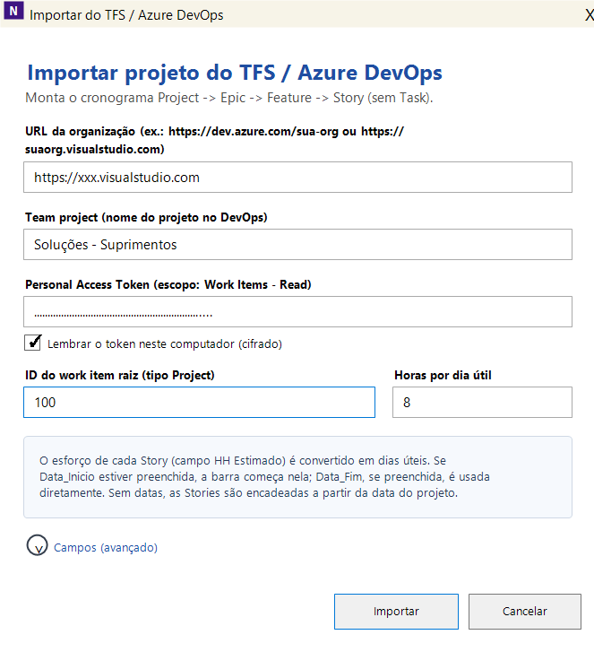
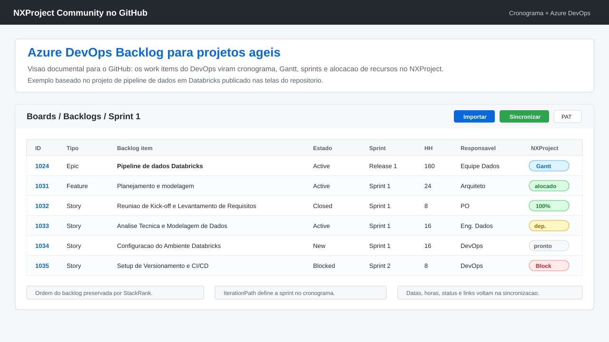

🌐 **Português** | [Read in English](README.md)

---

# NXProject Community

> **Novidade da 1.2:** além do Azure DevOps, o NXProject agora importa, exibe no TaskBoard e
> sincroniza com o **GitHub Projects**. Veja [Integração com GitHub Projects](#integração-com-github-projects-novidade-da-12).

**Visibilidade gerencial sobre o Azure DevOps e o GitHub Projects — sem mudar nada no fluxo da equipe técnica.**

O NXProject permite que Líderes Técnicos, Scrum Masters, Gerentes de Projeto e Gestores de Negócio enxerguem o cenário real do projeto a partir do Azure DevOps: cronograma, dependências, alocação de pessoas e Gantt — em um aplicativo desktop gratuito para Windows.

A equipe técnica continua trabalhando no servidor dela exatamente como antes: rastreabilidade de código, pull requests, pipelines e qualidade de entrega intactos. O NXProject lê esses dados e transforma o backlog em uma visão de planejamento que gestores e líderes conseguem usar para tomar decisões.


> Documentação por destino, com o que é lido, o que é devolvido e como configurar:
> [Azure DevOps](docs/devops/README.pt-BR.md) · [GitHub Projects](docs/gitproject/README.pt-BR.md).

---

## O problema que o NXProject resolve

Projetos de TI que usam Azure DevOps têm o backlog organizado, sprints definidas e work items atualizados — mas **a gestão não tem uma visão de cronograma integrada**. Perguntas simples ficam sem resposta rápida:

- Quando essa Feature vai terminar, considerando todas as Stories?
- Qual recurso está sobrecarregado no próximo mês?
- Se essa Story atrasar, o que mais é impactado?
- O projeto vai entregar no prazo?

O NXProject importa a hierarquia do Azure DevOps e transforma esses dados em um cronograma gerenciável, com Gantt, dependências, alocação e alertas de atraso — **sem que a equipe técnica precise mudar nada no seu processo**.

---

## Cada perfil vê o que precisa, sem atrito

A equipe de desenvolvimento segue usando o Azure DevOps como fonte da verdade: commits vinculados, code review, automação de pipeline e rastreabilidade completa permanecem inalterados. O NXProject é uma **camada de leitura e planejamento** sobre esses dados, voltada para quem precisa responder perguntas de prazo, capacidade e risco.

---

## A motivação por trás do NXProject

O NXProject não nasceu como um produto. Nasceu para resolver um problema real.

Na época, minha esposa estava cursando mestrado em Gestão da Educação e precisava elaborar o cronograma de um projeto relacionado à reforma de uma rampa em uma escola. A necessidade parecia simples: organizar atividades, dependências e acompanhar o planejamento de forma visual.

Procuramos ferramentas gratuitas para isso, mas as opções open source que encontramos estavam desatualizadas e as alternativas comerciais exigiam licenças que eu não tinha naquele momento — eu estava em transição entre empresas.

Então, em um fim de semana, decidi criar uma alternativa simples para transformar tarefas em um cronograma visual e facilitar o acompanhamento do projeto.

O objetivo inicial era apenas resolver aquele problema.

Mas durante o desenvolvimento percebi que o desafio era muito maior.

Depois de mais de 20 anos atuando com liderança técnica em dados e engenharia de software, percebi que o mesmo conflito aparecia repetidamente em projetos de tecnologia: ferramentas técnicas funcionavam muito bem para equipes de desenvolvimento e engenharia de dados, enquanto ferramentas de gestão entregavam cronogramas e relatórios — mas frequentemente à custa de processos paralelos, retrabalho e perda de rastreabilidade.

Equipes técnicas precisavam continuar trabalhando nas ferramentas do dia a dia.

Gestores precisavam entender prazo, capacidade, dependências e riscos.

Normalmente alguém precisava abrir mão de alguma coisa.

Foi quando o projeto deixou de ser apenas um gerador de cronogramas e evoluiu para o NXProject.

Meses depois, com o amadurecimento da ideia e o avanço das ferramentas modernas de desenvolvimento assistido por IA, após aprofundar o uso de ambientes como Codex e Claude Code, o produto evoluiu rapidamente. O que começou como um protótipo simples ganhou novas capacidades de planejamento, visualização e integração, permitindo acelerar a construção da visão que existia desde o início.

Mais tarde, ao integrar com Azure DevOps, percebi que o mesmo conceito também ajudava equipes reais de engenharia de software e engenharia de dados: os times continuavam trabalhando no fluxo já estabelecido — backlog, código, pipelines, automações e rastreabilidade — enquanto líderes e gestores finalmente ganhavam uma visão integrada de cronograma, dependências, capacidade e impacto.

Hoje o NXProject transforma dados do Azure DevOps em uma visão gerencial de planejamento e execução, permitindo que técnico e gestão trabalhem juntos — sem atrito, sem processos paralelos e sem abrir mão da rastreabilidade.

---

## Download

**Primeira instalação?** Baixe e rode o Setup — ele instala o runtime do .NET, as bibliotecas de terceiros e cria um atalho na Área de Trabalho, depois baixa automaticamente a versão mais recente do NXProject:

- [Baixar NXProject-Setup.zip](../../releases/latest/download/NXProject-Setup.zip)

**Já tem o NXProject instalado?** Basta baixar o pacote pequeno de atualização e extrair por cima da instalação existente:

- [Baixar NXProject.Community-Release.zip (atualização)](../../releases/latest/download/NXProject.Community-Release.zip)
- [Ver notas da versão e downloads do código-fonte](../../releases/latest)

> Sozinho, o `NXProject.Community-Release.zip` **não** inclui o runtime do .NET nem as bibliotecas de terceiros (PdfSharp, WebView2, CommunityToolkit.Mvvm, LLamaSharp) — ele só contém os arquivos do app (`.exe`/`.dll`) que mudam a cada release, e precisa ser extraído **por cima** de uma instalação já existente (feita pelo NXProject-Setup ou por uma versão completa anterior). Use o NXProject-Setup.zip para instalar em uma máquina nova.
>
> **Licenças de terceiros**: a distribuição inclui bibliotecas open source (na maioria sob licença MIT). Os avisos de copyright e os textos de licença estão no arquivo [`THIRD-PARTY-NOTICES.txt`](THIRD-PARTY-NOTICES.txt), incluído também nos zips.
>
> **Sobre a IA Local**: além do código compilado do NXProject, a distribuição inclui a `LLamaSharp.dll`, que é **apenas um wrapper .NET open source (licença MIT)** do llama.cpp — ela sozinha não executa nenhum modelo. O motor nativo (`llama.dll`) e o modelo GGUF **não** vêm no Setup: são baixados opcionalmente pelo próprio NXProject (menu IA → Gerenciar IA Local) para uma pasta escolhida pelo usuário, com validação e código auditável ([LLamaSharp](https://github.com/SciSharp/LLamaSharp) / [llama.cpp](https://github.com/ggml-org/llama.cpp)).
>
> Os binários foram gerados em ambiente com antivírus McAfee. Se preferir compilar você mesmo, veja as instruções abaixo.

---

## Se o Windows bloquear o .exe

O Windows pode recusar a abertura do `NXProject.Community.exe` com a tela azul do SmartScreen ("O Windows protegeu seu computador") ou simplesmente não fazer nada ao clicar duas vezes. Isso acontece porque o binário não é assinado digitalmente e foi baixado da internet.

### Opção 1 — Desbloquear via Propriedades (mais simples, não precisa de administrador)

1. Clique com o botão direito em `NXProject.Community.exe` → **Propriedades**
2. Na aba **Geral**, marque a caixa **Desbloquear** (parte inferior)
3. Clique em **OK** e abra o `.exe` novamente

Se a caixa não aparecer, o arquivo já está desbloqueado (ou seu sistema tem uma política mais restritiva — veja as opções abaixo).

### Opção 2 — Assinar com certificado de desenvolvedor local (recomendado para organizações)

Execute o script abaixo **como Administrador** uma vez. Ele cria um certificado autoassinado de code signing, instala como publisher confiável na máquina e assina todos os `.exe`/`.dll` do build:

```powershell
# Executar como Administrador na raiz do projeto
.\sign-nxproject.ps1
```

Depois disso, rode normalmente com `.\run-community.ps1` ou clicando duas vezes no `.exe`. **Não é necessário passar nenhum parâmetro** — o certificado fica instalado no store da máquina e o Windows o reconhece automaticamente.

> O certificado tem validade de 10 anos e cobre builds futuros — basta re-executar `sign-nxproject.ps1` após cada nova versão.

### Opção 3 — Política WDAC suplementar (para ambientes corporativos com controle de execução rígido)

Se sua organização usa Windows Defender Application Control (WDAC) e as opções acima não resolvem, execute o script WDAC como Administrador para liberar a pasta do NXProject:

```powershell
# Executar como Administrador
.\allow-nxproject-wdac.ps1
```

Isso cria uma política WDAC suplementar que permite executáveis da pasta do NXProject. Pode ser necessário reiniciar o computador.

> Esta opção só é necessária em ambientes corporativos com controle de execução rígido. A maioria dos usuários resolve com a Opção 1 ou 2.

---

## Capturas de tela






> As duas últimas imagens são ilustrações conceituais com dados fictícios, não capturas de tela.

---

## Para quem é o NXProject

| Perfil | O que o NXProject entrega |
|---|---|
| **Gerente de Projeto** | Cronograma integrado ao backlog, alertas de atraso, visão de dependências |
| **Scrum Master / RTE** | Capacidade por sprint, conflito de alocação, impacto de mudanças de data |
| **Tech Lead** | Visão de Features e Stories com predecessoras e estimativas em horas |
| **PMO** | Consolidação de múltiplos projetos, exportação para MS Project / Excel |

---

## Onde o NXProject se conecta

O NXProject trabalha contra dois servidores, e o cronograma, o TaskBoard e o Gantt são os mesmos
nos dois. Cada um tem a sua página, com o que é lido, o que é devolvido e como configurar:

| | |
|---|---|
| [**Azure DevOps**](docs/devops/README.pt-BR.md) | Work items, campos personalizados, ordem do backlog por `StackRank`, anexos e sincronização com controle de concorrência |
| [**GitHub Projects**](docs/gitproject/README.pt-BR.md) | Campos do projeto (board), hierarquia por sub-issues, ordem do backlog pela posição do item, anexos versionados no repositório |

Cada página também leva ao documento de **estado e decisões** daquele conector — inclusive o que
foi medido contra o que o desenho supunha. Esse é para quem mantém o código; as páginas acima são
para quem usa.

## Grau de liberdade: o cronograma vai até a Story, a Task vive no TaskBoard

O NXProject planeja até o nível de **Story**. A Task **não é planejada no cronograma** — ela nasce
e é conduzida no **TaskBoard**, durante a execução, por quem está fazendo o trabalho.

Isso é uma escolha, não uma limitação. Inspirado no conceito matemático de **grau de liberdade** —
usado para modelar sistemas complexos —, o NXProject estrutura a complexidade sem engessar o
processo: o planejamento define os **limites** (datas, recursos, dependências, ordem do backlog) e
preserva o espaço para o time técnico navegar com autonomia dentro deles.

Na prática, o grau de liberdade do NXProject **é o TaskBoard**:

- o gestor enxerga Story, prazo, alocação e impacto — e é nisso que ele se compromete;
- o desenvolvedor cria, divide, move e fecha Tasks no TaskBoard, sem pedir licença ao cronograma;
- as horas e o andamento das Tasks sobem para a Story, e o cronograma se ajusta sozinho.

Quem quiser as Tasks no cronograma pode carregá-las (**Load Task ToDo**, no Azure DevOps), mas aí
está abrindo mão de parte dessa liberdade de propósito — e o NXProject continua funcionando.

## Usabilidade

- **Gráfico de Gantt** interativo com zoom por dia, sprint ou período
- **Dependências entre tarefas** (predecessoras), inclusive entre Stories de Epics diferentes
- **TaskBoard** (visões Projeto & Story e Pessoa & Task): estado por arraste, Doing/Done, limite de WIP por pessoa e gravação em lote no DevOps
- **Task Plan**: planilha Excel de decomposição da Story em Tasks, com aplicação no cronograma e sincronização de volta
- **Alocação de recursos**: visão de carga por pessoa e período
- **Mapa de Alocação do Projeto**: distribuição por pessoa, projeto e mês, com apontamento de horas
- **Custo por recurso**: valor hora ou mensal, com totais por Feature, pessoa e mês
- **Caminho crítico (CPM)** e **linha de base (baseline)** para comparar planejado × replanejado
- **Health Check do Projeto**: lista tarefas atrasadas e sem responsável
- **Calendário configurável**: feriados, dias úteis, horas por dia
- **Exportação**: MS Project XML, OpenProj, Excel XML, CSV, **PDF (paisagem)**
- **IA**: assistente para sugestão de estrutura de tarefas, com opção de **IA Local** (modelo executado na própria máquina, sem enviar dados para a nuvem)
- **Portfólio de Projetos**: vários projetos DevOps num arquivo compartilhado, com OPEX/CAPEX e grupo administrador (`Adm_NX`)
- **Janela Tech Lead**: busca, cria e edita Tasks DevOps por Story; seleção em cascata Epic → Feature → Story pela toolbar, ou abertura direta pelo menu de contexto da Story
- **Coluna TKs** (modo expandido): exibe a contagem de Tasks filhas de cada Story no Azure DevOps — vermelho quando zero, para identificar Stories sem Tasks técnicas criadas
- **Campos Custom DevOps**: campos de classificação configuráveis por tipo de work item (Epic, Feature, Story); valores lidos na importação e editáveis via menu de contexto
- **Duplo clique para editar** o nome da atividade, evitando alterações acidentais ao navegar na grade
- **Multilíngue**: Português (Brasil) e Inglês, detectado automaticamente pelo Windows e alternável nas Configurações

---

## Compilar a partir do código-fonte

Pré-requisitos: [.NET 10 SDK](https://dotnet.microsoft.com/en-us/download/dotnet/10.0) e [VS Code](https://code.visualstudio.com/download).

```powershell
# Preparar ambiente
.\setup-community-vscode.ps1

# Compilar
.\build-community.ps1 -Configuration Release

# Ou gerar o pacote de release (zip de atualizacao + Setup)
.\release-community-new-version.ps1 -Configuration Release
```

O executável de desenvolvimento será gerado em `NXProject.Community\bin\Release\net10.0-windows\`.

> **Importante — gerar o `.exe` oficial de release**
>
> Use sempre `dotnet publish --self-contained true -r win-x64` (ou o script de release do projeto, que já faz isso automaticamente).
> Se usar apenas `dotnet build`, o `.exe` gerado pode falhar em máquinas com o registro do .NET corrompido ou incompleto, exibindo uma mensagem enganosa como:
>
> ```
> To run this application, you must install .NET.
> ```
>
> …mesmo que `dotnet --list-runtimes` mostre o .NET instalado corretamente.
> A publicação self-contained resolve isso porque o runtime é copiado junto do `.exe` na pasta de publicação.
>
> Atenção: o `NXProject.Community-Release.zip` publicado nas releases é o **pacote de atualização** — ele contém só os arquivos que mudam a cada versão e depende de uma instalação feita pelo `NXProject-Setup.zip`. Para instalar em uma máquina nova, use sempre o Setup.

---

## Licença e contato

- **Empresa**: Nexus XData Tecnologia Ltda
- **Contato comercial**: `comercial.nexus.xdata@gmail.com`

O NXProject usa modelo **Open Core / licenciamento dual**:

| Edição | Uso |
|---|---|
| **Community (gratuita)** | Uso livre para pessoas físicas e empresas, inclusive uso comercial interno, sem limite de usuários. Redistribuição gratuita permitida mantendo o crédito à Nexus XData. |
| **Comercial / Enterprise** | Sem restrições de revenda ou SaaS, suporte oficial, SLA, módulos exclusivos (impressão/PDF, calendário avançado, integrações com IA). Contate-nos para proposta. |

> Vender, cobrar ou oferecer o NXProject como serviço pago exige licença comercial.

---

## Conte como o NXProject está ajudando o seu projeto

Se o NXProject está sendo usado na sua empresa e está fazendo diferença — seja na visibilidade do cronograma, na gestão de equipe ou na integração com o Azure DevOps — **queremos saber**.

Envie um relato curto para `comercial.nexus.xdata@gmail.com` contando:

- O contexto do projeto (tamanho da equipe, segmento, desafio que tinha)
- O que melhorou depois que passou a usar o NXProject
- Se autoriza, divulgamos o caso como referência para a comunidade

Relatos reais ajudam a priorizar melhorias, atraem novos colaboradores e mostram para outras equipes que o produto funciona na prática. **Sua experiência pode ajudar outros projetos.**
