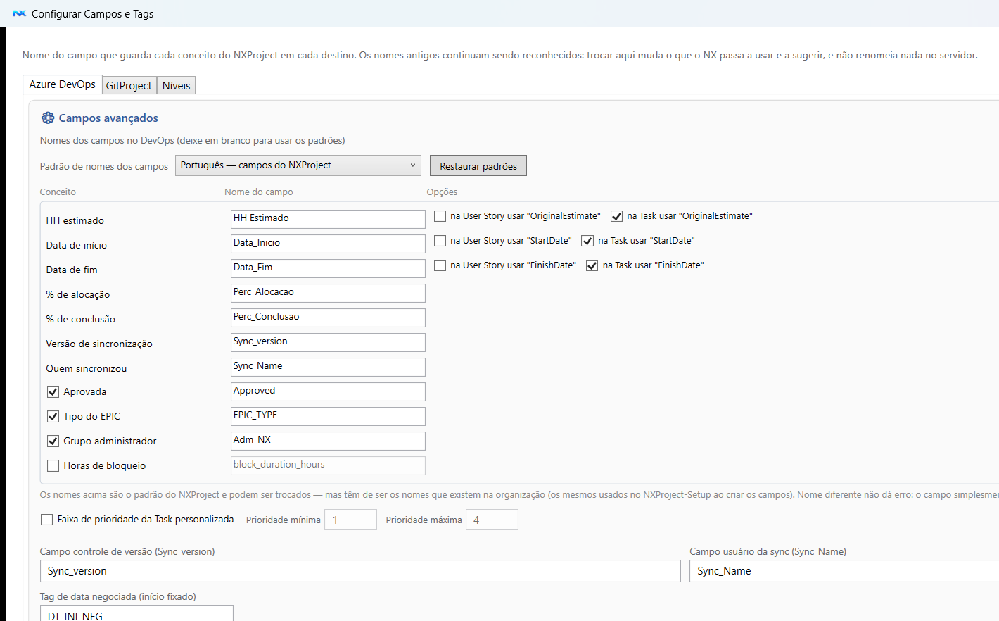

🌐 **Português** | [Read in English](README.md)

# NXProject com Azure DevOps

Como o NXProject transforma o backlog do Azure DevOps num cronograma gerenciável — o que ele lê,
o que devolve e como configurar.

- [Voltar para a página principal](../../README.pt-BR.md)
- [Estado e decisões por trás do conector](features.pt-BR.md) — para quem mexe nele

---

## Integração com Azure DevOps

### Do backlog ao cronograma em minutos

O NXProject importa a hierarquia completa do seu projeto diretamente do Azure DevOps:

```
Project → Epic → Feature → Story
```

Cada Story vira uma linha do cronograma com data de início, duração calculada em dias úteis, responsável e sprint — tudo extraído dos campos que seu time já preenche no DevOps.

### Até onde o cronograma vai

O NXProject planeja até o nível de **Story**; a Task nasce e é conduzida no TaskBoard. No Azure
DevOps dá para trazer as Tasks para o cronograma (**Load Task ToDo**), quando o seu processo pede
isso. O porquê dessa divisão está em
[Grau de liberdade](../../README.pt-BR.md#grau-de-liberdade-o-cronograma-vai-até-a-story-a-task-vive-no-taskboard),
na página principal.

### TaskBoard: onde a execução acontece

O cronograma responde "quando"; o **TaskBoard** mostra "quem está fazendo o quê, agora". Ele lê as Tasks da sprint direto do Azure DevOps e as organiza em colunas por estado (New, Active, Resolved, Closed), em duas visões:

- **Projeto & Story** — as Stories nas colunas de estado, agrupadas por Projeto, EPIC e Feature. É a visão de acompanhamento do gestor.
- **Pessoa & Task** — uma faixa por pessoa e, dentro dela, uma linha por Story com as Tasks distribuídas nas colunas (a ilustração acima). É a visão do dia a dia do time.

O que o board faz além de listar:

- **Arrastar a Task entre colunas muda o estado**; nada vai para o DevOps na hora — as alterações entram numa fila e são gravadas em lote no botão **Atualizar TFS**, com relatório do que mudou.
- **Doing / Done**: marcas do que a pessoa está fazendo agora e do que terminou mas ainda não foi encerrado no DevOps (viram tags no work item).
- **Limite de WIP por pessoa** (não por projeto): o board conta as Tasks em andamento de cada um e sinaliza quem passou do limite.
- **Alerta de estado incoerente**: a Story fica destacada quando o estado dela não acompanha o das Tasks — Story em New com Task já iniciada, ou Story em Active sem nenhuma Task em Active.
- **Bloqueio (tag `BLOCK`)**, sprint, responsável, prioridade, HH estimado/realizado e descrição, todos editáveis a partir do card.
- **Filtros** por pessoa, Story, estado, sprint (uma ou várias), além de recortes como "somente bloqueadas", "somente Task Active" e "somente Story do cronograma".

É no TaskBoard que o grau de liberdade descrito acima se materializa: o planejamento entrega a Story, e o time cria e conduz as Tasks a partir dali.

### Lista de Projetos DevOps

Gerencie múltiplos projetos DevOps em um arquivo compartilhado entre toda a equipe. Cada projeto tem nome e ID raiz; ao importar, basta selecionar o projeto da lista, sem precisar lembrar o ID manualmente.

### O que é lido automaticamente

- **Hierarquia**: `Project → Epic → Feature → Story` via links `Child`
- **Estimativas**: campo `HH Estimado` → duração em dias úteis no calendário do projeto
- **Datas**: `Data_Inicio` e `Data_Fim` quando já definidas no DevOps
- **Responsável**: `System.AssignedTo` → recurso do projeto
- **Sprint**: `System.IterationPath` → associação com sprints do NXProject
- **Ordem do backlog**: `Microsoft.VSTS.Common.StackRank`
- **Bloqueios**: Tasks filhas com tag `Block` marcam a Story como bloqueada
- **Estado**: Stories `Closed`/`Resolved` com Tasks filhas ainda em aberto são sinalizadas e corrigidas automaticamente
- **% de Alocação**: `Perc_Alocacao` — percentual do dia da pessoa dedicado a esta Story (afeta a data fim calculada)
- **Controle de versão**: `Sync_version` e `Sync_Name` — controle de concorrência entre múltiplos usuários (veja abaixo)

> Os nomes dos campos podem ser alterados no expansor **Campos (avançado)** da tela de importação, caso o seu processo use nomes diferentes.

---

### Item raiz e hierarquia (tipo `Project`)

O NXProject monta o cronograma na hierarquia **Project → Epic → Feature → Story → Task**.

> ⚠️ **`Project` não é um tipo de work item padrão do Azure DevOps** (o padrão vai só até Epic). É um tipo **personalizado** que funciona como "container" acima dos Epics, agrupando o projeto inteiro. Muitas organizações criam esse tipo no processo.

Como o item raiz é usado:

- **Importação manual:** você informa o **ID do item raiz** na tela de importação; o NXProject importa os descendentes (Epic → Feature → Story → Task). O tipo do raiz **não** precisa ser exatamente `Project` — pode ser qualquer work item que seja pai dos Epics (inclusive um Epic, se quiser importar só ele).
- **Discovery** (Portfólio → Discovery DevOps): lista automaticamente os work items **do tipo `Project`** sem pai no Team Project. Para o Discovery automático funcionar, o tipo personalizado `Project` precisa existir.

Se a sua organização não usa um tipo `Project`, você ainda importa apontando o ID raiz para um Epic (ou outro container) — apenas o Discovery automático depende do tipo `Project`.

> **Campos no tipo `Project`:** como ele fica no topo da hierarquia, crie nele os **mesmos campos personalizados do Epic** (`HH Estimado`, `Data_Inicio`, `Data_Fim`, `Sync_version`, `Sync_Name`). Na prática o tipo `Project` costuma ser uma cópia do Epic. O NXProject lê a data de início do projeto (`Data_Inicio`) direto do item raiz.

---

### Campos no DevOps: o que é obrigatório e o que é opcional

O NXProject lê e grava alguns campos personalizados no Azure DevOps. Crie-os no template de processo em **Configurações da Organização → Processo → [Seu Processo]** e adicione-os aos tipos de work item indicados na coluna **Usado em**.

> **Antes de criar na mão, use o NXProject-Setup.** O **Passo 4** do instalador detecta o que já existe na sua organização, **cria só o que falta** e permite **exportar/importar** a configuração em `.json` para a equipe inteira. A mesma detecção está no NXProject, em **Configuração Integração Azure DevOps → Campos avançados**; a criação é exclusiva do instalador.

> **Use os campos de fábrica quando puder.** O Azure DevOps já traz `Start Date` e `Finish Date` na **Task** e na **Story**, e `Original Estimate` na Task. O NXProject usa os da Task por padrão e **oferece o mesmo para a Story**: marque *"na Story usar Start Date / Finish Date"* (nas duas telas) e você **não precisa criar** `Data_Inicio`/`Data_Fim`. A escolha é gravada por tipo de work item, então quem já usa os personalizados continua como está.

#### Obrigatórios

| Nome do campo (exibição) | Nome de referência | Tipo | Padrão no NXProject | Usado em | Finalidade |
|---|---|---|---|---|---|
| `HH Estimado` | `Custom.HHEstimado` *(exemplo)* | Decimal | `HH Estimado` | Story *(na Task, `Original Estimate` de fábrica)* | Esforço estimado em horas |
| `Data_Inicio` | `Custom.DataInicio` *(exemplo)* | Data/Hora | `Data_Inicio` | Story, Task — **ou** `Start Date` de fábrica | Data de início planejada |
| `Data_Fim` | `Custom.DataFim` *(exemplo)* | Data/Hora | `Data_Fim` | Story, Task — **ou** `Finish Date` de fábrica | Data de fim planejada (data alvo no TaskBoard) |

#### Opcionais

Cada um liga um recurso. Sem o campo, o NXProject funciona — só aquele recurso fica de fora.

| Nome do campo (exibição) | Nome de referência | Tipo | Padrão no NXProject | Usado em | Finalidade |
|---|---|---|---|---|---|
| `HH Original` | `Esforço Estimado` *(padrão)* | Decimal | `Esforço Estimado` / `nx_original_hours` | Story — na Task, `Original Estimate` | Horas planejadas originalmente. Preserva o plano quando o item chega a 100% |
| `HH Restante` | `HH_Restante_float` *(padrão)* | Decimal | `HH_Restante_float` / `nx_remaining_hours` | Story — na Task, `Remaining Work` | Horas que ainda faltam. **Tem prioridade sobre o `HH Estimado`** na importação |
| `HH Atual` | `HH_Atual_float` *(padrão)* | Decimal | `HH_Atual_float` / `nx_completed_hours` | Story — na Task, `Completed Work` | Horas já realizadas. Entra na duração total (`HH Atual + HH Restante`) e no percentual |
| `Perc_Alocacao` | `Custom.PercAlocacao` *(exemplo)* | Decimal/Float (1–100, até 2 casas) | `Perc_Alocacao` | Story, Task | % do dia da pessoa dedicado a esta Story |
| `Perc_Conclusao` | `Custom.PercConclusao` *(exemplo)* | Inteiro (0–100) | `Perc_Conclusao` | Story | % de conclusão. **Sem o campo**, o percentual vem do estado do work item |
| `EPIC_TYPE` | `Custom.EPIC_TYPE` *(exemplo)* | Texto (lista: `DELIVERY` / `BACKLOG` / `EPIC_GROUP`) | `EPIC_TYPE` | Epic | Classifica o Epic: **Delivery** (soma horas no total do projeto), **Backlog** (não soma) ou **EPIC_GROUP** (um Epic que agrupa Epics). Habilitado por padrão. |
| `Type` *(classificação)* | `Custom.Type` *(exemplo)* | Picklist | `Custom.Type` | Feature | Classificação da Feature, exibida no cronograma e no TaskBoard. Valores de fábrica: `Architecture`, `Burocracy`, `Docs`, `Feature`, `Hotfix`, `Refactor`, `Request`. O campo e a lista são configuráveis em **Configurar Campos e Tags**, e a mesma lista semeia o single-select do board no GitProject. |
| `Tipo_Centro_Custo` | `Custom.Tipo_Centro_Custo` *(exemplo)* | Texto (`OPEX` / `CAPEX`) | `Tipo_Centro_Custo` | Epic | Tipo do centro de custo — usado no **Portfólio de Projetos** (OPEX/CAPEX) |
| `block_duration_hours` | `Custom.block_duration_hours` *(exemplo)* | Decimal | `block_duration_hours` | Task | Horas acumuladas em BLOCK, calculadas do histórico. **Desligado por padrão** |
| `Approved` | `Custom.Approved` *(exemplo)* | Booleano | `Approved` | Task | Aprovação da Task. Habilitado por padrão |
| `Sync_version` | `Custom.Syncversion` *(exemplo)* | Inteiro | `Sync_version` | Story, Feature, Epic | Contador de versão de concorrência (gerenciado automaticamente) |
| `Sync_Name` | `Custom.SyncName` *(exemplo)* | Texto *(texto simples, não Identity)* | `Sync_Name` | Story, Feature, Epic | Quem realizou a última sincronização (gerenciado automaticamente) |
| `Adm_NX` | `Custom.Adm_NX` *(exemplo)* | Identity (aponta um grupo/Team do DevOps) | `Adm_NX` | Project (item raiz) | Grupo administrador do NX: **somente os membros deste grupo podem Exportar/Sincronizar** no DevOps. Vazio/ausente = liberado para todos. Habilitado por padrão. |

> **Feature e EPIC não precisam de HH nem de datas.** Nesses níveis os números são **consolidação dos filhos**, calculada pelo cronograma — não há o que preencher. Só `Sync_version` e `Sync_Name` fazem falta ali, porque o controle de concorrência acompanha todo item sincronizado. (Se os campos existirem na Feature/EPIC, o NXProject publica o rollup neles.)

> **Por que o `HH Original` e o `HH Estimado` apontam para o mesmo campo.** É o mesmo número em
> dois momentos. Enquanto a atividade não começou, o que está no campo é a estimativa. Quando
> ela começa, o NXProject guarda aquele valor inicial como **HH Original**, e o campo passa a
> ser o **registro do plano**: o andamento não é mais gravado ali — vai para o `HH Atual` e o
> `HH Restante`, e o esforço estimado de agora é a soma dos dois. Por isso os dois conceitos
> têm o mesmo nome padrão, e o sync grava nesse campo **uma só vez** (a estimativa de quem
> executa muda; o plano, não). Para manter os dois números separados no servidor, aponte o
> `HH Original` para um campo próprio na tela de campos.

> **Os campos de HH e o processo.** Na Task o NXProject usa os campos nativos `Original Estimate`, `Remaining Work` e `Completed Work` — mas eles são de fábrica no **Agile** e no **CMMI**; a Task do **Scrum** traz `Remaining Work` e pode não ter os outros. Por isso cada um dos três aparece na tela de campos com o nome **por tipo** ao lado: marcado, usa o nativo; desmarcado, você digita o campo próprio daquele tipo. Nenhum deles é obrigatório — sem o `HH Restante` o NX usa o `HH Estimado` como restante, sem o `HH Atual` a Story fica sem horas realizadas e sem o `HH Original` o plano não é preservado em item concluído.

> Os nomes de referência acima são exemplos — o Azure DevOps os gera automaticamente a partir do nome de exibição e do prefixo da sua organização.  
> Se os seus campos tiverem nomes diferentes, ajuste-os no NXProject em **Configuração Integração Azure DevOps → Campos avançados**, onde todos os nomes são configuráveis: HH Estimado, Data_Inicio, Data_Fim, Perc_Alocacao, Perc_Conclusao, EPIC_TYPE, Tipo_Centro_Custo, Sync_version, Sync_Name, Adm_NX e block_duration_hours.

> **Não quer adivinhar os nomes? Use "Detectar campos DevOps".** No fim de **Campos avançados** há um botão que pergunta ao DevOps quais dos nomes digitados existem de fato, **em quais tipos de work item** (Task, User Story, Feature, Epic, Project) e com que tipo de dado. Ele também avisa quando o campo foi encontrado por um **nome alternativo** — o NXProject aceita alguns por campo, por isso `HH Estimado` funciona mesmo quando o campo se chama `Esforço Estimado` na API — e marca ou desmarca os checkboxes dos recursos opcionais conforme o que achou. Nada é gravado no DevOps e nada é salvo até você clicar em **Salvar**; o **Cancelar** desfaz.
>
> A detecção responde apenas se o campo existe e onde. Regra de processo, permissão de escrita e tipo de dado incompatível só aparecem quando o NXProject grava de verdade — se o import ou a sincronização falhar por isso, a mensagem de erro aponta o campo.

> **Grupo administrador (`Adm_NX`) — quem pode sincronizar.** Crie no work item raiz (`Project`) um campo **Identity** chamado `Adm_NX` e aponte-o para um **grupo/Team** do Azure DevOps. Só os **membros desse grupo** poderão Exportar/Sincronizar no DevOps a partir do cronograma importado; edição local e Task Plan continuam livres para todos. O grupo é exibido no banner e no editor do **Portfólio de Projetos**. A validação de quem pode sincronizar é feita **ao vivo** no momento do Sincronizar — o NXProject **relê o campo `Adm_NX` direto do work item `Project` no DevOps** e compara com o usuário autenticado (dono do PAT), sem depender do checkbox de configuração nem do que ficou salvo no `.nxp`; assim, desligar a opção depois de importar **não** desliga a trava. Campo vazio/ausente no work item `Project` = **liberado para todos**. Substitui o antigo "Somente leitura" do Portfólio. Configurável (habilitar/nome) em **Campos avançados**.
>
> **Importante:** depois de criar o campo `Adm_NX` no *template* do processo, é preciso **abrir cada work item `Project`, selecionar o grupo e salvar** (Save). Enquanto o valor não for gravado no item, o campo fica vazio na API — mesmo que apareça no formulário — e o NXProject lê como "liberado para todos".

> **Ordem do backlog (StackRank / BacklogPriority):** o NXProject grava a ordem do backlog no campo padrão do processo — `Microsoft.VSTS.Common.StackRank` em **Agile/CMMI/Basic** e `Microsoft.VSTS.Common.BacklogPriority` em **Scrum**. Esses campos já existem no processo (não precisam ser criados). O processo do Team Project é lido automaticamente na importação/descoberta e exibido no banner e no editor do Portfólio.

> **Dica:** crie os campos uma vez no nível do processo e adicione-os a Story, Feature e Epic — todos os tipos compartilham a mesma definição de campo.

#### Campos da Task (nenhum campo customizado necessário)

A **Task** usa apenas campos **padrão** do Azure DevOps, que já existem no tipo Task — você **não** precisa criar nenhum campo customizado:

| Conceito no NXProject | Campo padrão (referência) | Observação |
|---|---|---|
| HH Estimado | `Microsoft.VSTS.Scheduling.OriginalEstimate` | Esforço estimado da Task |
| HH Atual | `Microsoft.VSTS.Scheduling.CompletedWork` | Trabalho concluído |
| Prioridade | `Microsoft.VSTS.Common.Priority` | O formulário padrão do DevOps usa 1–4; no NXProject a faixa é configurável (padrão 1–9) |
| Ordem do backlog | `Microsoft.VSTS.Common.StackRank` / `BacklogPriority` | Campo padrão do processo (não precisa criar) |
| Responsável / Estado / Categoria | `System.AssignedTo` / `System.State` / `Microsoft.VSTS.Common.Activity` | — |

> **Campo `block_duration_hours` (opcional, na Task).** Campo numérico que guarda **quantas horas o
> item ficou impedido** (bloqueado com a tag BLOCK), sempre em horas inteiras — menos de uma hora vira
> `0`. O NXProject recalcula o total a partir do histórico do DevOps quando você desbloqueia, e o card
> da Task passa a mostrar um atalho ⏱ para a **Auditoria de BLOCK** quando o valor for maior que zero.
> **Desabilitado por padrão e totalmente opcional**: deixe o checkbox desmarcado — em **Campos
> avançados** — e o NXProject nunca grava nele. O bloqueio continua funcionando com a tag mais um
> trâmite, e a Auditoria de BLOCK (botão direito no card da Story ou da Task) segue lendo o histórico
> completo online, com ou sem esse campo. Nada é exigido do template do processo.

> **Campo `Approved` (opcional, só na Task).** Se o seu processo tiver um campo booleano `Approved` (`Custom.Approved`) na Task, o NXProject lê e grava a aprovação da Task. Habilitado por padrão; se a Task não tiver o campo, é ignorado. Configurável em **Campos avançados**.

> Datas, `Perc_Alocacao`, `EPIC_TYPE`, `Tipo_Centro_Custo` e `Sync_version`/`Sync_Name` **não** se aplicam à Task — o planejamento (datas e duração) é derivado da Story pai.

#### Controle de concorrência (`Sync_version` / `Sync_Name`)

Quando dois usuários sincronizam alterações simultaneamente, a última gravação poderia sobrescrever a primeira. O NXProject evita isso com o par `Sync_version` / `Sync_Name`, que deve existir em todos os tipos de work item sincronizados (Story, Feature e Epic):

- A cada sincronização que grava ao menos uma alteração real, `Sync_version` é incrementado em 1 e `Sync_Name` recebe o usuário Windows atual.
- Ao sincronizar, o NXProject compara a versão que leu no import com a versão atual no DevOps. Se a versão do DevOps for maior, outro usuário gravou mais recentemente — o item é **ignorado** e marcado em **vermelho** no cronograma.
- Itens vermelhos permanecem destacados até que você reimporte o projeto. O log de sincronização mostra quais itens tiveram conflito.
- Ao clicar em um item vermelho na coluna de estado, a janela de vínculo DevOps exibe um aviso de conflito com o botão **↓ Reimportar** para iniciar o import diretamente.
- O contador de versão reinicia em 1 ao atingir o limite inteiro.

> **`Sync_Name` deve ser do tipo texto simples, não Identity.** Se foi criado como campo Identity (seletor de pessoa), exclua e recrie como **Texto (linha única)**.

### Log de importação

Ao importar, o NXProject gera um relatório com:
- Stories cujo estado foi corrigido automaticamente (ex: Story fechada com Task em aberto)
- Predecessoras que apontam para itens fora do escopo importado
- Avisos e inconsistências para revisão antes de publicar o cronograma

### Sincronização de volta ao DevOps

Após ajustar datas, dependências e estimativas no cronograma, o NXProject sincroniza as alterações de volta para o Azure DevOps: título, descrição, horas, datas, estado, tags, sprint e links de predecessora.

### Abrir work item direto no DevOps

Em qualquer tarefa vinculada, o botão **"Abrir no DevOps ↗"** abre o work item no browser. A janela de vínculo também exibe a lista de Tasks filhas com ID, nome e estado — para referência rápida sem sair do NXProject.

---

---


## Configurar o Azure DevOps

### Personal Access Token

1. No Azure DevOps, clique no ícone de usuário → **Personal access tokens**
2. Clique em **New Token**
3. Em **Scopes**, selecione **Work Items → Read** (adicione **Write** se quiser sincronizar de volta)
4. Copie o token e cole no campo correspondente na tela de importação do NXProject

O token pode ser salvo localmente cifrado com as credenciais do Windows (DPAPI).

### Campos personalizados

Se o seu processo usa nomes de campo diferentes de `HH Estimado`, `Data_Inicio` ou `Data_Fim`, esses nomes podem ser ajustados na área **Campos (avançado)** da janela de importação.

### Calendário de trabalho

Configure feriados, horas úteis por dia e dias da semana em **Exibir → Calendário...**  
O padrão é 8 horas por dia, segunda a sexta.

---

## A tela de campos



Os nomes dos campos no DevOps, o padrão PT/EN e, por tipo de work item, a opção de usar o campo
**nativo** do processo em vez de um campo próprio. Abaixo da lista ficam a detecção e a criação —
esta pedindo o PAT de administrador na hora, sem gravá-lo.
