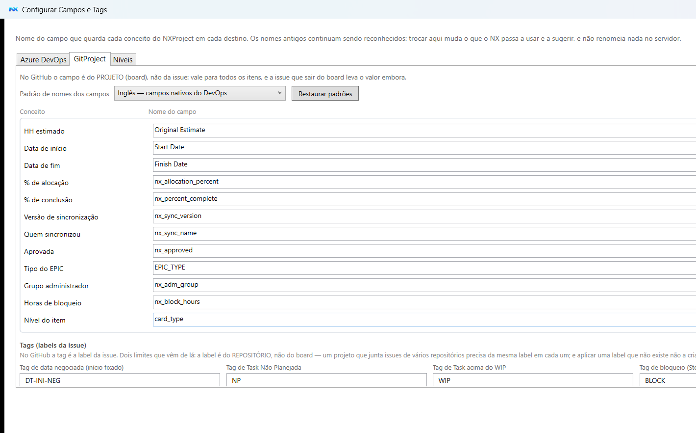

🌐 **Português** | [Read in English](README.md)

# NXProject com GitHub Projects

A partir da versão 1.2 o NXProject também trabalha contra o GitHub Projects (Projects v2) —
importar, TaskBoard e sincronizar, sem Azure DevOps.

- [Voltar para a página principal](../../README.pt-BR.md)
- [Estado e decisões por trás do conector](features.pt-BR.md) — para quem mexe nele

---


A partir da **versão 1.2** o NXProject também trabalha contra o **GitHub Projects (Projects v2)**,
e não só o Azure DevOps. Times que vivem no GitHub — e que não têm licença nem apetite para o
DevOps — passam a ter a mesma coisa: cronograma com datas calculadas, alocação de pessoas e um
board que respeita a hierarquia do backlog. O GitHub Projects é gratuito em repositórios públicos e
privados, pessoais e de organização, então o custo de adoção do NXProject cai a zero para eles.

### O que funciona contra o GitHub

| | |
|---|---|
| **Importar** | Board inteiro ou um ramo a partir de uma issue raiz; hierarquia pelas sub-issues, datas e HH nos campos do projeto, sprint no campo de iteração |
| **TaskBoard** | As colunas saem do `Status` do próprio projeto, não de um conjunto fixo |
| **Sincronizar** | Datas, HH, percentual, estado da issue (100% fecha, voltar a andar reabre), responsável, labels, itens novos e **ordem do backlog** |
| **Hierarquia** | O GitHub não valida nada, então quem valida é o NXProject: item fora de Project → Epic → Feature → Story → Task é recusado **antes** de qualquer gravação |
| **Concorrência** | O `Sync_version` espelha a revisão do próprio servidor (`updatedAt`), então alteração feita **pela tela do GitHub** também é detectada — e o aviso diz quem fez |
| **Auditoria de BLOCK** | Reconstruída da timeline da issue (label que entra e sai, com hora e autor) |
| **Anexos** | O GitHub não tem API de anexo de item: o arquivo é versionado no repositório da issue, numa árvore de pastas que espelha o backlog, com o link comentado no item |

### Campos: o NXProject cria para você

O NXProject precisa de alguns campos para guardar o planejamento. **Você não precisa criá-los à
mão em nenhum dos dois lados:**

- **GitHub Projects** — no NXProject, abra **Importar → Configurar Campos e Tags → aba GitProject**
  e use **Criar campos no board**. Ele cria o que falta já com o tipo certo (número para HH, data
  para datas, single-select para o `card_type`), junto com os seus campos de classificação. Criar
  campo no GitHub **não exige ser administrador da organização** — basta ter acesso ao projeto.
- **Azure DevOps** — o instalador **NXProject-Setup** detecta o que falta no processo e cria (esse
  sim exige *Project Collection Administrator*, porque mexe no processo). A mesma tela dentro do
  NXProject permite renomear qualquer campo para o nome que a sua organização já usa.

Os dois lados compartilham um catálogo de campos e um mapa de níveis, então campo ou tipo
renomeado na sua organização é configuração, não alteração de código.

### Abrir direto a tela de campos (linha de comando)

O NXProject aceita um parâmetro que abre **só** a tela "Configurar Campos e Tags", sem carregar o
cronograma. É por aqui que o NXProject-Setup encaminha quem vai configurar o GitProject — o
instalador não tem uma segunda tela para isso, e configuração de campo fica num lugar só.

```
NXProject.Community.exe --setup            # a tela, com as duas abas
NXProject.Community.exe --setup=devops      # já na aba Azure DevOps
NXProject.Community.exe --setup=gitproject  # já na aba GitProject
```

O aplicativo abre apenas essa janela e encerra quando ela fecha. No instalador, o botão
**"Abrir no NXProject"** (Passo 4, ao lado da escolha do servidor) faz exatamente essa chamada,
já no destino selecionado.


### Token do GitHub

Um token **classic** com os escopos `repo` e `project`. A tela de configuração explica a árvore de
escopos, os dois enganos mais comuns (`repo:invite` não basta; token fine-grained não expõe a
permissão de Projects em board de conta pessoal) e a alternativa por organização, que evita dar
acesso ao código. O token fica cifrado pelo Windows (DPAPI), nunca em texto plano.

> **Processos do Azure DevOps:** testado em produção com o **Agile**. Scrum e CMMI são tratados no
> código (ordem por `BacklogPriority`, tipos `Product Backlog Item` e `Requirement`, estados
> `Approved`/`Committed`/`Proposed`), mas ainda não foram exercitados contra um servidor real.
> Detalhes em [funcionalidades do Azure DevOps](../devops/features.pt-BR.md#processos-agile-é-o-que-foi-testado).

## A tela de campos



Os nomes dos campos do board, com o padrão PT/EN, as tags e a classificação. O botão **Criar os
campos no board do GitHub** cria o que falta já com o tipo certo — e, no GitHub, isso não exige ser
administrador da organização.

No GitHub não existe campo nativo nenhum, então os três campos de horas — `HH Original`,
`HH Restante` e `HH Atual` — são campos do board como os demais, criados pelo mesmo botão e com
tipo *number*. O `HH Restante` tem prioridade sobre o HH estimado na leitura, e o `HH Original`
preserva o plano quando o item fecha.

A classificação nasce copiando a do Azure DevOps: o picklist `Custom.Type` vira um single-select do
board com os mesmos valores de fábrica — `Architecture`, `Burocracy`, `Docs`, `Feature`, `Hotfix`, `Refactor`, `Request` — e o **valor
padrão**, logo abaixo da lista, é o que o NXProject grava ao criar o item sem classificação. Os dois
são editáveis, e o botão **Restaurar padrão** devolve a lista de fábrica sem tocar nos campos que
você acrescentou.
